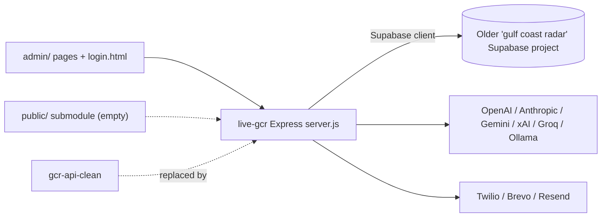

# live-gcr

An early (May 2026) Gulf Coast Radar (GCR) bundle: an Express API plus the admin pages, meant to also serve the public site (which is missing).

## What it is

A Node/Express backend for the GCR business directory together with the admin dashboard front end, all in one repo. The `package.json` calls it "unified public site + admin + API", but the public-site folder is an empty submodule pointer, so only the API and admin pages are actually here. It talks to an older "gulf coast radar" Supabase project, not to the database used by the current API (`gcr-api-clean`).

## How it works

- `server.js` - Express app on `PORT` (default 3001). It mounts `/api/gcr` (`routes/gcr.js`, 46 routes), `/api/auth` (`routes/auth.js`, 9 routes: login, signup, session, refresh, password reset), `/api/dashboard` (`routes/dashboard.js`, 188 routes: bookings, menus, fleet, coupons, loyalty, events), `/api/update` and `/update` (`routes/update-link.js`, 36 routes, the owner "update link" flow), and `/api/health`.
- `routes/ai-provider.js` - switches between OpenAI, Anthropic, Gemini, xAI, Groq and Ollama.
- `utils/sms.js`, `utils/email.js` - SMS and email sending (Twilio, Brevo, Resend); `middleware/auth.js`; `lib/` - entity resolution and menu helpers.
- `gcr-db.js` / `db.js` - create the Supabase client used by the routes.
- Front end: `admin/` (index, businesses, editors, analytics, automations, components), root `js/`, `css/`, `login.html`.
- `vercel.json` - builds `server.js` with `@vercel/node`, sends `/api/*` to it, and routes `/` and other paths to `/public/...`. `public` is a git submodule pointer with no `.gitmodules`, so it checks out empty and the public site returns 404.

## Run it

```bash
npm install
npm start          # node server.js, http://localhost:3001
```

Environment variable names read by the code include `JWT_SECRET`, `SUPABASE_URL`, `SUPABASE_SERVICE_KEY`, `PORT`, `GCR_ADMIN_SECRET`, `REINDEX_SECRET`, `PLATFORM_ADMIN_EMAIL`, `PUBLIC_SITE_BASE_URL`, `LINKS_BASE_URL`, `AI_PROVIDER`, `OPENAI_API_KEY`, `ANTHROPIC_API_KEY`, `GEMINI_API_KEY`, `GROQ_API_KEY`, `XAI_API_KEY`, `TWILIO_ACCOUNT_SID`, `TWILIO_AUTH_TOKEN`, `TWILIO_PHONE_NUMBER`, `BREVO_API_KEY`, `STRIPE_SECRET_KEY`. Without them the server starts but most routes will fail.

## Status

**Stalled.** A single-commit (2026-05-13) backend-plus-admin bundle tied to the superseded database, with the public site absent; replaced by `gcr-api-clean` and `cybercheck-login`.

## Where it fits



## Related repos

- `gcr-api-clean` - the current API that superseded this kind of backend.
- `cybercheck-login`, `gcr-admin` - later admin front ends; about 30 admin/js files are identical to files here.
- `live-gcr-` - similarly named repo, a separate repo not compared here.
